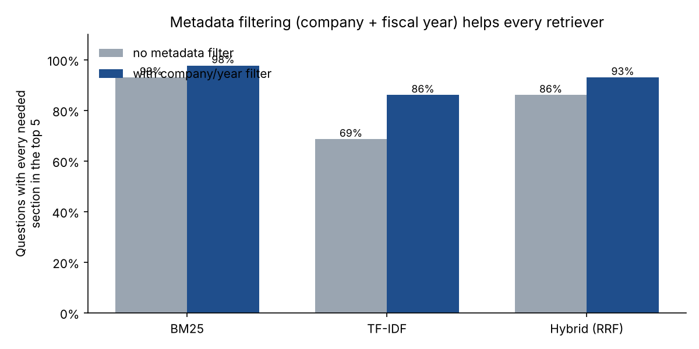

# Financial Documents Assistant: RAG on Databricks, Evaluated Like It Matters

A retrieval-augmented generation (RAG) assistant that answers questions about company annual reports **with citations**, refuses when the answer isn't in the documents, and is measured against a gold-standard question set. It's built for **Databricks Mosaic AI** (Vector Search, Foundation Model APIs, MLflow, Agent Evaluation, Model Serving), with a fully local version for development and testing.

   

> **Data note:** the corpus is 12 annual-report-style documents for **six fictional financial-services companies** (a regional bank, a payments processor, an insurer, a banking-software vendor, a consumer lender and a wealth manager) over fiscal 2024–2025, produced by [`data/generate_corpus.py`](data/generate_corpus.py). Every figure comes from a fact table, so each of the 98 evaluation questions has a **known answer and a known source section**.

> **What has and hasn't been run:** everything under `src/` and `tests/` runs locally (`make all`), and the numbers below come from that run. The four Databricks notebooks in [`notebooks/`](notebooks/) are written against the Databricks APIs but **have not yet been executed in a workspace**. Their results will be added when they are.

---

## Why this project

Most RAG demos show a chat box answering a handful of questions. Financial-services clients need more than that before anything ships:
1. **Evidence.** Answers must cite the source.
2. **Refusal.** "I don't know" is better than a confident wrong number.
3. **Measurement.** Retrieval quality and answer quality are tested separately, on questions with known answers.

This project builds the evaluation harness first and treats the model as one replaceable component.

## Architecture

```
                       ┌──────────────────────────── Databricks ────────────────────────────┐
 Annual reports  ──►   │  UC Volume ──► chunking ──► Delta table (CDF) ──► Vector Search      │
 (Markdown/PDF)        │                (section-aware,                    Delta Sync index   │
                       │                 metadata-tagged)                  (managed embeddings)│
                       │                                                         │            │
 Question ──► parse company / fiscal-year filters ──► hybrid search (filtered) ─┘            │
                       │                                      │                               │
                       │                     top-5 chunks + citation-required prompt          │
                       │                                      ▼                               │
                       │                     Foundation Model API (Llama 3.3 70B)             │
                       │                                      ▼                               │
                       │     answer with [citations]  or  "I can't find that in the reports." │
                       │                                                                      │
                       │  MLflow pyfunc ─► Unity Catalog model ─► Agent Evaluation ─► Serving │
                       └──────────────────────────────────────────────────────────────────────┘
```

| Notebook | What it does |
|---|---|
| [`01_ingest_and_chunk.py`](notebooks/01_ingest_and_chunk.py) | Reads reports from a Unity Catalog volume, chunks them by section, writes a Delta table with Change Data Feed |
| [`02_vector_search_index.py`](notebooks/02_vector_search_index.py) | Creates a Vector Search endpoint and a Delta Sync index with `databricks-gte-large-en` embeddings; compares plain, filtered and hybrid search |
| [`03_rag_chain_and_evaluation.py`](notebooks/03_rag_chain_and_evaluation.py) | Wraps retrieval and generation as an MLflow `PythonModel`, registers it in Unity Catalog, and evaluates it with `mlflow.evaluate(model_type="databricks-agent")` on the 98 gold questions |
| [`04_deploy.py`](notebooks/04_deploy.py) | Deploys with `databricks.agents.deploy`, giving a serving endpoint, a Review App for stakeholder feedback, and inference tables |

## Local results (keyword retrieval + extractive answerer)

The local pipeline swaps the Databricks components for ones with no dependencies (BM25/TF-IDF instead of embeddings, an extractive answerer instead of an LLM), so the **retrieval design and the evaluation harness** can be developed and tested offline.

### Evaluation set: 98 questions with known answers
| Type | Count | Example |
|---|---|---|
| Lookup | 72 | "How much cash and cash equivalents did Atlas Consumer Lending have at the end of fiscal 2025?" |
| Comparison (multi-hop) | 12 | "Did NovaPay Technologies' operating margin improve from fiscal 2024 to fiscal 2025?" |
| Cross-company | 2 | "Which company had the highest operating margin in fiscal 2024?" |
| **Unanswerable** | 12 | "Who is Crestview Insurance Group's independent auditor?" *(not in the reports, so the right answer is a refusal)* |

### Retrieval: metadata filtering matters most
Twelve reports share the same structure, so "total revenue in fiscal 2025" appears in **every** report. Keywords alone can't reliably separate one company and year from another. **Parsing the company and fiscal year out of the question and filtering on them first** improved every retriever:

| Retriever | Filter | All needed sections in top 5 | Recall@5 | MRR |
|---|---|---|---|---|
| BM25 | — | 93.0% | 95.0% | 0.873 |
| TF-IDF | — | 68.6% | 73.4% | 0.605 |
| Hybrid (BM25 + TF-IDF, RRF) | — | 86.0% | 90.3% | 0.738 |
| **BM25** | **company + year** | **97.7%** | **99.6%** | **0.878** |
| TF-IDF | company + year | 86.0% | 90.9% | 0.644 |
| Hybrid | company + year | 93.0% | 97.3% | 0.776 |



Hybrid fusion didn't help *locally* because TF-IDF is the weaker partner on templated text. On Databricks, hybrid means BM25-style keywords plus **dense embeddings**, a much stronger pairing. Notebook 02 compares those options directly.

### End to end (best retriever + extractive answerer)
| | |
|---|---|
| Lookup answers exactly correct | **73.6%** |
| Comparison / cross-company answers | 0%, by design (extracting one sentence can't combine two facts; this needs the LLM) |
| Unanswerable questions correctly refused | **100% (12/12)** |
| Answerable questions wrongly refused | **0%** |
| Answers whose numbers all appear in the retrieved context | 100% |

**What the gap tells us:** retrieval finds the right sections 99.6% of the time, but picking one sentence gets only 74% of lookups right and none of the multi-hop questions. **The remaining errors are in the answering step, not retrieval**, which is exactly where the LLM goes in notebook 03. Having the harness in place means the LLM's contribution can be measured on the same 98 questions rather than judged from a demo. Per-question results: [`question_level_results.csv`](reports/tables/question_level_results.csv).

## Design decisions

- **Section-aware chunks with a source prefix.** Each chunk begins with "*Company (TICKER) annual report, fiscal YEAR.*", so both keyword and embedding retrieval can see where it came from (a cheap form of contextual chunking).
- **Self-querying filters.** Company and fiscal year are parsed from the question and applied as Vector Search `filters`. Guidance questions ("what did X guide for fiscal 2026?") map to the *prior* year's report.
- **Citation-required prompt.** The [prompt](prompts/answer_with_citations.md) requires `[chunk_id]` citations, figures quoted exactly as written, and a fixed refusal sentence, so refusals can be scored automatically.
- **Two refusal checks.** The question asks about a year outside the corpus, or no retrieved sentence shares a content word with the question beyond the company name.
- **Groundedness check.** Every number in an answer must appear in the retrieved text, a cheap guard against invented numbers that runs on every response.
- **Lower BM25 `k1` (0.5).** In short, templated sections, a term that repeats ("revenue" in a segment table) shouldn't dominate. Tuning note: this was chosen on the evaluation set itself; with real documents, tune on a separate development set.

## Repository structure

```
├── data/
│   ├── generate_corpus.py           # fictional annual reports + gold Q&A
│   ├── corpus/*.md                  # 12 generated reports
│   └── eval_questions.json          # 98 questions with answers and gold source sections
├── prompts/answer_with_citations.md
├── src/finrag/
│   ├── chunking.py                  # section-aware, metadata-tagged chunks (shared with notebook 01)
│   ├── retrieval.py                 # BM25, TF-IDF, RRF hybrid, company/year filter extraction
│   ├── answer.py                    # extractive answerer + OpenAI-compatible LLM answerer
│   ├── evaluate.py                  # recall@k, MRR, correctness, groundedness, abstention
│   └── pipeline.py                  # retrieval ablation + end-to-end evaluation
├── notebooks/                       # Databricks: ingest, Vector Search, MLflow + Agent Evaluation, deploy
├── reports/                         # metrics.json, figures/, tables/
└── tests/                           # chunking, filtering, abstention and metric tests
```

## Run it

**Locally (about 5 seconds):**
```bash
git clone https://github.com/chatnic/genai-financial-docs-assistant.git
cd genai-financial-docs-assistant
python -m venv .venv && source .venv/bin/activate
make setup && make all
```

**On Databricks:** add the repo as a Git folder, upload `data/corpus/*.md` to the volume created in notebook 01, then run notebooks 01 → 04. You'll need Unity Catalog, a Vector Search endpoint quota, and access to the Foundation Model APIs.

**Any OpenAI-compatible LLM, locally:** set `LLM_BASE_URL`, `LLM_API_KEY` and `LLM_MODEL` and use `finrag.answer.LLMAnswerer`.

## Next steps

- Run notebooks 01–04 and add the Agent Evaluation results (correctness, groundedness, retrieval recall) alongside the local baseline.
- Replace the generated Markdown with real SEC 10-K filings (PDF parsing, tables), keeping the same evaluation harness.
- Add a query router that sends multi-hop comparison questions to a two-step "retrieve for each entity, then compare" chain.

## License

MIT. See [LICENSE](LICENSE).
